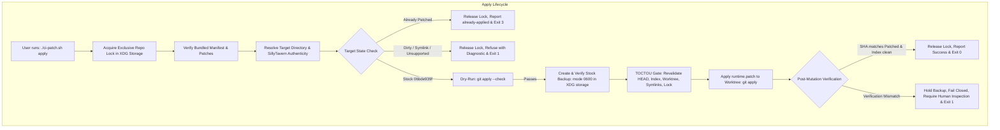
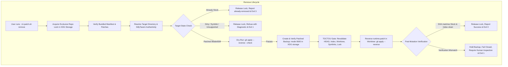

# Mission D01-SP-2: Simplified Apply/Remove Architecture Plan (v1.1)

> Technical Design & Architecture Specification for Chromatic Images Git Patch Manager (SP-2)
> Document Version: 1.1.0 (historical design text — D01-SP-2-P0)
> Original date: 2026-10-22
> Disposition (2026-10-25): **Implemented / reviewed / published through V3-I1; owner-run Android V3-Q2 acceptance PASS**. This design document is preserved as a historical proposal, not an exact description of every final implementation detail.
> Published public CLI: [`10ca7d502d9b26803c16d3493f442b706276cd78`](https://github.com/zNe4/SillyTavern-ChromaticImages/commit/10ca7d502d9b26803c16d3493f442b706276cd78). See [current SP-2 implementation and P3B distinction](d01-installer-progress.md) and [device acceptance record](d01-sp2-v3-q2-android-acceptance.md).

---

## 1. Architecture Overview

### 1.1 Objective and Context
Mission **D01-SP-1** established the read-only foundation for the SillyTavern patch manager:
- Status inspection (`./ci-patch.sh status`)
- Forward preflight checks (`./ci-patch.sh check`)
- Upstream release compatibility auditing (`./ci-patch.sh check-release`)
- Binary-safe Git operations, legacy transaction diagnostics, and offline cryptographic manifest verification

The `apply` and `remove` commands were deliberately left disabled in SP-1.

The objective of **D01-SP-2** is to enable `./ci-patch.sh apply` and `./ci-patch.sh remove` using standard Git patch operations and minimal, robust safety machinery.

We explicitly reject the multi-phase transactional installer model of D01-P3B (leases, `.ci-patch` transaction journals, candidate files, `/proc/self/fd` directory descriptors). Applying one verified patch to one known endpoint file (`src/endpoints/stable-diffusion.js`) does not justify thousands of lines of transaction machinery.

### 1.2 Core Architectural Principles
1. **Standard Git Patch Operations**: Apply and remove use `git apply` and `git apply --reverse` targeting the working tree exclusively.
2. **Unmodified Git Index and Commit Log**: The Git index blob, mode, and staging area remain 100% clean and unshifted. No Git commits are created.
3. **Decoupled User-Local Storage**: Backups and lock files live in user-local storage under `${XDG_DATA_HOME:-$HOME/.local/share}/chromatic-images/`. They are strictly external to the SillyTavern repository and independent of the ChromaticImages installation location.
4. **Symmetric Pre-Mutation Recovery Snapshots**:
   - `apply`: captures and cryptographically verifies a backup of the stock endpoint before mutating.
   - `remove`: captures and cryptographically verifies a backup of the patched endpoint before reversing.
   - `remove` operates independently of any backup created during a previous `apply`.
   - Backups are never automatically deleted after success.
5. **Simple Exclusive Process Locking**: One non-reentrant, exclusive lock per canonical target repository. No leases, no heartbeat timers, no automatic stale-lock recovery. Existing or ambiguous locks fail closed.
6. **Strong Pre-Mutation TOCTOU Revalidation**: Immediately before invoking Git, all environmental, repository, index, target fingerprint, and lock ownership invariants are revalidated.
7. **Post-Mutation Verification**: The resulting endpoint SHA-256 is verified and the Git index is checked to guarantee it remained untouched.
8. **Conservative Failure Handling & Safe Recovery**: In partial or ambiguous failure, no destructive commands (`git checkout`, `git reset`) are executed automatically. Observed and expected fingerprints and backup locations are surfaced, requiring explicit human inspection.





---

## 2. Apply and Remove State Table

The table below defines how `./ci-patch.sh apply` and `./ci-patch.sh remove` behave across all target states:

| Observed State | Pre-conditions / Observations | `./ci-patch.sh apply` Action | `./ci-patch.sh remove` Action | Exit Code |
|---|---|---|---|:---:|
| **Clean Stock (Not Installed)** | Certified commit `06bde939f`, target SHA `15439f...`, index blob `077c2f...`, index mode `100644`, clean index | Creates verified stock backup (`0600`), revalidates, applies patch to worktree, verifies patched SHA `16c01a...` and clean index. | Recognizes target is already stock. No-op. Reports already-removed. | Apply: 0<br>Remove: 3 |
| **Clean Patched (Installed)** | Certified commit `06bde939f`, target SHA `16c01a...`, index blob `077c2f...`, index mode `100644`, clean index | Recognizes target is already patched. No-op. Reports already-applied. | Creates verified patched backup (`0600`), revalidates, applies reverse patch, verifies stock SHA `15439f...` and clean index. | Apply: 3<br>Remove: 0 |
| **Target Modified (Unrecognized)** | Certified commit `06bde939f`, target SHA is neither stock nor patched | **Refuses**. Reports fingerprint mismatch. Does not mutate or overwrite. | **Refuses**. Reports fingerprint mismatch. Does not mutate or overwrite. | 1 |
| **Target Staged Changes** | Certified commit `06bde939f`, target has staged index changes | **Refuses**. Reports staged changes on target file. | **Refuses**. Reports staged changes on target file. | 1 |
| **Target Merge Conflict** | Index stage > 0 for target file | **Refuses**. Reports active merge conflicts. | **Refuses**. Reports active merge conflicts. | 1 |
| **Target or Parent Symlink** | Symlink detected on target or parent (`src`, `src/endpoints`) | **Refuses**. Reports unsafe symlink in path. | **Refuses**. Reports unsafe symlink in path. | 1 |
| **Unsupported Revision** | HEAD commit ≠ `06bde939fb1e9c4c8d8641d810f0a916b5bce127` | **Refuses**. Reports unsupported revision. (Even if patch applies cleanly). | **Refuses**. Reports unsupported revision. Does not auto-reverse. | 1 |
| **Legacy Transaction Pending** | `.ci-patch` directory present or `transaction.isPending === true` | **Refuses**. Reports legacy installer transaction state. | **Refuses**. Reports legacy installer transaction state. | 1 |
| **Target Missing** | `src/endpoints/stable-diffusion.js` does not exist | **Refuses**. Reports missing target file. | **Refuses**. Reports missing target file. | 1 |
| **Invalid Installation / Package** | Not a Git repo, missing `package.json`/`server.js`, or tampered patch manifest | **Refuses** with diagnostic. | **Refuses** with diagnostic. | 1 |
| **Lock Held by Another Process** | Existing lock file exists and is held or ambiguous | **Refuses**. Reports concurrent operation in progress. | **Refuses**. Reports concurrent operation in progress. | 1 |
| **Unrelated Working-Tree Changes** | Other files (e.g. `public/index.html`) modified, but target is clean stock/patched | **Proceeds**. Preserves unrelated files completely. | **Proceeds**. Preserves unrelated files completely. | Apply: 0<br>Remove: 0 |

---

## 3. Backup and Recovery Design

### 3.1 Storage Location and Validation
- **Base Directory**: User-local storage under `${XDG_DATA_HOME:-$HOME/.local/share}/chromatic-images/backups/`.
- **Directory Permissions**: Created with mode `0700` (`fs.mkdirSync(dir, { recursive: true, mode: 0o700 })`). If the directory already exists, its mode is verified and set to `0700`.
- **Isolation Constraint**: The resolved backup directory **must** reside outside the SillyTavern repository tree:
  `canonicalBackupDir.startsWith(canonicalRepoRoot + path.sep)` must be **false**.
- **Symlink Refusal**: Neither the backup directory nor any of its parent segments may be symbolic links.
- **Environment Override**: An optional `CI_BACKUP_DIR` environment variable is supported for specialized test harnesses, but must satisfy all validation rules: must be an absolute or resolvable directory, must reside strictly outside the SillyTavern repository, and must reject symlinks. An invalid override causes immediate refusal.
- **Location Independence**: Moving or updating the ChromaticImages repository does not affect existing backups or recovery capability.

### 3.2 Symmetric Pre-Mutation Snapshots
Both operations create a verified backup immediately before mutation:
- **`apply`**: Preserves the original stock endpoint file.
  - Filename format:
    `stable-diffusion.js.<YYYYMMDD-HHmmss>.<repoHash>.<rand6Hex>.stock.bak`
- **`remove`**: Preserves the exact patched endpoint file.
  - Filename format:
    `stable-diffusion.js.<YYYYMMDD-HHmmss>.<repoHash>.<rand6Hex>.patched.bak`
- **Metadata Descriptor**: Written alongside each `.bak` file as `.meta.json`:
  ```json
  {
    "schemaVersion": "1.1.0",
    "createdAt": "2026-10-22T20:30:00.000Z",
    "operation": "apply",
    "repoRoot": "/canonical/path/to/SillyTavern",
    "repoHash": "a1b2c3d4e5f6",
    "targetFile": "src/endpoints/stable-diffusion.js",
    "sha256": "15439fdffd839815ef7adcaa39806738c4e4503db8bbb697b337e905dfb4ed43",
    "targetMode": "0644",
    "backupFileName": "stable-diffusion.js.20261022-203000.a1b2c3d4e5f6.1a2b3c.stock.bak"
  }
  ```

### 3.3 Safe File Creation & Durability
- Backup files are created with mode `0600` using exclusive creation flags:
  `fs.constants.O_CREAT | fs.constants.O_EXCL | fs.constants.O_WRONLY`.
- Bytes written to the backup file are explicitly flushed with `fsyncSync(fd)` before descriptor close.
- The backup file's SHA-256 and size are re-read and verified against the expected fingerprint:
  - `manifest.patches.runtime.original.sha256` for `apply`.
  - `manifest.patches.runtime.expected.sha256` for `remove`.
- **Mandatory Mutation Gate**: If backup creation or backup verification fails for any reason (e.g. disk full, permission denied, SHA mismatch), the operation **fails closed immediately**, and the target file is never touched.

### 3.4 Retention Policy & Removal Independence
- **Preserved on Success**: Backups are retained after successful operations. No automatic deletion occurs.
- **Preserved on Failure**: On any error or post-mutation failure, backups are strictly preserved.
- **Independence of Remove**: `./ci-patch.sh remove` does **not** depend on the backup created by an earlier `apply`. It takes its own snapshot of the patched endpoint, verifies it, and applies `git apply --reverse`.

---

## 4. Concurrent Operations and Process Locking

### 4.1 Exclusive Process Lock Design
To prevent concurrent invocations from corrupting the target installation:
- **Lock Directory**: `${XDG_DATA_HOME:-$HOME/.local/share}/chromatic-images/locks/` (mode `0700`).
- **Lock File**: Named by canonical repository identity: `<repoHash>.lock`.
- **Atomic Creation**: Created exclusively with `O_CREAT | O_EXCL | O_WRONLY` (mode `0600`).
- **Lock Content (JSON)**:
  ```json
  {
    "lockVersion": 1,
    "pid": 12345,
    "nonce": "e4f82a91b0c3d5e7",
    "operation": "apply",
    "repoRoot": "/canonical/path/to/SillyTavern",
    "createdAt": "2026-10-22T20:30:00.000Z"
  }
  ```

### 4.2 Strict Ownership and Release Rules
- **No Leases or Heartbeats**: The lock is an unforgeable in-process token.
- **No Automatic Stale-Lock Breaking**: If a lock file exists, `./ci-patch.sh` **refuses to run** and exits with code 1. It outputs the lock details (PID, timestamp, operation, and lock file path) and instructs the user to inspect the system manually.
- **Verified Lock Release**:
  - The lock is released only by the process that created it.
  - Before unlinking the lock, the process reads back the lock file and verifies that the `pid` and `nonce` match its own. If the lock was replaced or modified by a third party, the process will not unlink it.
  - Cleanup is registered via `process.on('exit')` and explicit `try ... finally` blocks.

### 4.3 Concurrent Same-UID Limitations
Under POSIX semantics, another process running with the same UID has full permissions to write to repository files or attempt to unlink files. No userland tool can completely block an active, same-UID racer without kernel-level mandatory locking.
Our architecture addresses this reality by:
1. Locking the repository in user-local storage to prevent accidental double-invocations.
2. Revalidating all file and index invariants immediately before mutation (TOCTOU guard).
3. Verifying the final result and Git index immediately after mutation, failing closed if any divergence is detected.

---

## 5. Pre-Mutation Revalidation (TOCTOU Gate) & Failure Handling

### 5.1 Immediate Pre-Mutation Revalidation
Immediately before invoking `git apply` or `git apply --reverse`, the runner executes a synchronous revalidation:
1. **Certified HEAD**: HEAD commit is still `06bde939fb1e9c4c8d8641d810f0a916b5bce127`.
2. **Index Blob & Mode**: `src/endpoints/stable-diffusion.js` index blob is still stock `077c2f961b528afa10376a7cc20a62132cf9fcd8`, mode is `100644`, and stage is 0.
3. **No Staged Changes**: `diff-index --cached HEAD` confirms zero staged changes on the target.
4. **Target File Identity**: Target file is a regular file, not a symlink, intermediate directories are not symlinks, and content SHA-256 matches expected pre-state (`15439f...` for apply, `16c01a...` for remove).
5. **No Legacy Pending Transaction**: `inspectTransactionState` confirms no pending `.ci-patch` transaction.
6. **Lock Ownership Verified**: The lock file on disk is re-read and confirmed to still belong to the current PID and nonce.

If any check fails, mutation is aborted before Git is called.

### 5.2 Post-Mutation Verification
Directly after `git apply` terminates:
1. **Target Content**: The target file is re-read and its SHA-256 is computed. It must match the expected post-state (`16c01a...` for apply, `15439f...` for remove).
2. **Git Index Invariant**: The Git index is checked to confirm it remained completely unshifted (`077c2f...`, mode `100644`, clean).
3. **Unrelated Files**: Status is checked to confirm no unrelated files were touched.

### 5.3 Ambiguous Failure & Recovery Rules
- **No Automatic Rollback on Ambiguous Failure**: If `git apply` fails midway or the post-mutation SHA does not match, the runner **must not** attempt an automatic rollback or automatic restoration.
- **No Destructive Suggestions**: The runner **must not** suggest running `git checkout`, `git reset`, or `git clean`, which could destroy user-owned uncommitted work.
- **Diagnostic Reporting**: On partial or verification failure, the runner outputs:
  - Exact observed target SHA-256 and file size.
  - Expected target SHA-256.
  - Absolute path to the verified pre-mutation backup file and its metadata descriptor.
  - Explicit notice requiring human inspection before manual restoration.

---

## 6. Compatibility Lifecycle

### 6.1 Strict Certification Boundary
- Bundled manifest certifies exclusively SillyTavern release `06bde939fb1e9c4c8d8641d810f0a916b5bce127`.
- An uncertified release—even one where `runtime.patch` applies cleanly in dry-run—is classified as `applies-unverified` and is **rejected** by both `apply` and `remove`.

### 6.2 Safe User Workflow for Updating SillyTavern
The safe user procedure for updating SillyTavern is:
1. Verify current status:
   ```bash
   ./ci-patch.sh status
   ```
2. Remove the patch from the certified release:
   ```bash
   ./ci-patch.sh remove
   ```
   (Target file is restored to clean stock `06bde939f`).
3. Update SillyTavern normally:
   ```bash
   git -C /path/to/SillyTavern pull
   ```
4. Run compatibility preflight:
   ```bash
   ./ci-patch.sh check-release
   ```
5. Reapply only when Chromatic Images provides a certified manifest for the new release:
   ```bash
   ./ci-patch.sh apply
   ```

### 6.3 If Updated While Patched
If SillyTavern was updated while patched:
- HEAD commit is no longer `06bde939f`.
- `./ci-patch.sh remove` will refuse with `unsupported-revision`.
- The runner outputs the detected commit, explains that automatic reversal is unsafe on an uncertified revision, reports the location of the patched-state backup, and requires human inspection.

---

## 7. Files to Add or Modify

### 7.1 Modified Files
1. **`scripts/sillytavern-patch.mjs`**:
   - Re-enable `apply` and `remove` commands (replacing the exit 2 stubs).
   - Wire commands to `applyPatchToInstallation` and `removePatchFromInstallation`.
   - Add `formatApplyOutput` and `formatRemoveOutput`.
   - Support `--json` structured output for both commands.
   - Update `--help` text to document commands and exit codes (0 = success, 1 = refused/error, 2 = usage, 3 = already satisfied).
2. **`src/patch-installer/git-ops.js`**:
   - Add `applyPatchWorktree(repoRoot, patchPath, { reverse = false, timeout = 10000 })`: executes `git apply` or `git apply --reverse` strictly against the working tree without `--index` or `--cached`.

### 7.2 New Files
1. **`src/patch-installer/simple-backup.js`**:
   - Manages user-local storage under `${XDG_DATA_HOME:-$HOME/.local/share}/chromatic-images/`:
     - `resolveBackupStorageDir(repoRoot, customOverride)`: validates directory is outside SillyTavern, mode `0700`, no symlinks.
     - `createPreMutationBackup({ repoRoot, targetFilePath, expectedSha256, operation, backupDir })`: creates `0600` backup with `O_CREAT | O_EXCL`, writes bytes, `fsyncSync`, verifies SHA-256, writes `.meta.json`.
     - `acquireProcessLock(repoRoot, operation, lockDir)`: creates `<repoHash>.lock` with `O_CREAT | O_EXCL`, stores PID and nonce.
     - `releaseProcessLock(lockHandle)`: verifies PID and nonce before unlinking.
2. **`src/patch-installer/apply-remove.js`**:
   - Implements the complete lifecycle for `applyPatchToInstallation` and `removePatchFromInstallation`:
     - Lock acquisition.
     - Package verification and target inspection.
     - State verification (`not-installed` for apply, `installed` for remove; exit 3 if already satisfied).
     - Dry-run verification (`git apply --check` or `git apply --reverse --check`).
     - Pre-mutation backup creation.
     - Pre-mutation TOCTOU revalidation.
     - Execution of `applyPatchWorktree`.
     - Post-mutation verification of SHA-256 and index cleanliness.
     - Safe lock release in `finally` block.

---

## 8. Test Matrix

| Test Suite / Category | Scope | Verification Cases |
|---|---|---|
| **Unit: Simple Backup & Storage** | In-process & temp files | - Directory created with mode `0700`<br>- Backup file created with mode `0600`<br>- SHA-256 and size verification of written backup<br>- Metadata `.meta.json` created and schema-validated<br>- Rejection if backup directory is inside SillyTavern repo<br>- Rejection if backup directory or parents contain symlinks<br>- Rejection on invalid `CI_BACKUP_DIR` override<br>- Safe handling of disk full / write failure (fails closed before mutation) |
| **Unit: Process Locking** | In-process & temp files | - Exclusive lock creation with mode `0600`<br>- Rejection when lock file already exists (concurrent invocation)<br>- Stale lock refusal without auto-breaking<br>- Ownership check before release (refuses to delete if PID/nonce mismatch)<br>- Proper lock release in normal and error `finally` paths |
| **Disposable Git Integration — Apply** | Disposable Git fixtures in `/tmp` | - Clean apply on stock repo: transitions to patched SHA, index clean, stock backup verified<br>- Double apply: returns exit 3 (`already-applied`), no mutation<br>- Pre-mutation backup created and verified before any target write<br>- Refuses if target is dirty (unstaged modifications)<br>- Refuses if target has staged changes in index<br>- Refuses if target or parent directory is a symlink<br>- Refuses if HEAD commit ≠ `06bde939f`<br>- Refuses if legacy pending `.ci-patch` transaction exists<br>- TOCTOU: aborts if HEAD, index, or target file changes after preflight<br>- Post-apply SHA mismatch handling: fails closed, preserves backup, requires human inspection |
| **Disposable Git Integration — Remove** | Disposable Git fixtures in `/tmp` | - Clean remove on patched repo: transitions to stock SHA, index clean, patched backup verified<br>- Double remove: returns exit 3 (`already-removed` / `not-installed`), no mutation<br>- Removal succeeds independently of earlier apply backup<br>- Pre-mutation backup created and verified before reverse apply<br>- Refuses if target is dirty / unrecognized SHA<br>- Refuses if staged changes exist<br>- Refuses if HEAD commit ≠ `06bde939f` (e.g. updated while patched)<br>- Preserves unrelated working-tree modifications<br>- TOCTOU: aborts if repository state changes immediately before reverse apply<br>- Post-remove verification failure handling |
| **Authentic Pinned-Release Gate** | Pinned commit `06bde939f` | - Mandatory gate: exercise full apply -> status -> remove -> status round-trip on authentic SillyTavern commit `06bde939fb1e9c4c8d8641d810f0a916b5bce127`<br>- Verify exact stock SHA `15439f...` and patched SHA `16c01a...`<br>- Verify Git index remains unshifted throughout |
| **Android / Termux Acceptance** | Real device | - Non-root execution in Termux environment<br>- Correct XDG storage path resolution and `0700`/`0600` permissions<br>- Clean execution of apply and remove |

---

## 9. Implementation Stages

### Stage SP-2-A: Apply Implementation
1. Add `applyPatchWorktree` in [`src/patch-installer/git-ops.js`](file:///home/zzzne4/Desktop/Utils/chromatic-images/src/patch-installer/git-ops.js).
2. Implement [`src/patch-installer/simple-backup.js`](file:///home/zzzne4/Desktop/Utils/chromatic-images/src/patch-installer/simple-backup.js) (storage resolution, mode `0700`/`0600`, backup creation/verification, process locking).
3. Implement `applyPatchToInstallation` in [`src/patch-installer/apply-remove.js`](file:///home/zzzne4/Desktop/Utils/chromatic-images/src/patch-installer/apply-remove.js).
4. Wire `apply` in [`scripts/sillytavern-patch.mjs`](file:///home/zzzne4/Desktop/Utils/chromatic-images/scripts/sillytavern-patch.mjs) with formatted and JSON output.
5. Implement unit and disposable Git integration tests in `tests/sillytavern-patch-apply.test.mjs`.
6. Run `npm test` and syntax checks.

### Stage SP-2-R: Remove Implementation
1. Implement `removePatchFromInstallation` in [`src/patch-installer/apply-remove.js`](file:///home/zzzne4/Desktop/Utils/chromatic-images/src/patch-installer/apply-remove.js) with symmetric pre-mutation snapshot.
2. Wire `remove` in [`scripts/sillytavern-patch.mjs`](file:///home/zzzne4/Desktop/Utils/chromatic-images/scripts/sillytavern-patch.mjs) with formatted and JSON output.
3. Verify removal functions independently of earlier apply backups.
4. Implement unit and disposable Git integration tests in `tests/sillytavern-patch-remove.test.mjs`.
5. Run `npm test` and syntax checks.

### Stage SP-2-V: Authentic Integration & Verification Gate
1. Implement authentic pinned-release test cases exercising the full lifecycle against `06bde939fb1e9c4c8d8641d810f0a916b5bce127`.
2. Verify all failure boundary tests (TOCTOU race injection, lock collision, invalid backup storage).
3. Run complete verification gate: `npm test`, `npm run verify:patches`, repository-wide `node --check`.
4. Document test execution evidence and submit for independent review. Production mutation enablement remains blocked until this gate passes.
